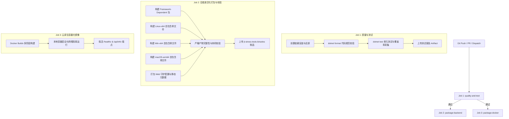

# GitHub Actions CI/CD 自动化工作流配置与管理规范

本文档详尽阐述 `JTStressTests` 项目的 GitHub Actions 持续集成与持续交付 (CI/CD) 自动化工作流架构、管理规则、环境依赖规范、构建输出路径定义、差异化构建策略以及本地复现指南。

---

## 1. 核心管理规则 (Management Rules)

### 1.1 分支管理与触发规则
- **代码提交 (Push 触发)**：
  - 监听主分支 `main`、`master` 以及版本发布分支 `release/**`。
  - 自动忽略纯文档变更（`*.md`, `docs/**`），节省 CI 资源。
- **合并请求 (Pull Request 触发)**：
  - 监听针对目标分支 `main`、`master` 发起的 PR 请求。
  - PR 必须通过 `quality-and-test`（代码规范校验和单元测试）阶段所有 Check，方可允许合并。
- **手动调度 (workflow_dispatch)**：
  - 支持仓库管理员通过 GitHub 界面手动触发，并提供目标部署环境输入（`Development`、`Staging`、`Production`）。

### 1.2 权限控制与安全准则 (Least Privilege)
- **Token 权限最小化**：
  - `contents: read`：只读检出代码仓库；
  - `checks: write`：允许工作流上报测试运行结果与质量门禁状态；
  - `pull-requests: write`：允许就测试和构建状态在 PR 评论中自动反馈。
- **依赖防篡改与缓存安全**：
  - 基于 `*.csproj` 与 lock 文件的 SHA256 哈希作为 NuGet 缓存 Key，防止依赖污染与陈旧缓存失效。

---

## 2. 环境依赖要求 (Environment & Dependencies)

CI 运行环境及本地开发运行环境必须满足以下最低依赖要求：

| 依赖组件 | CI 运行环境配置 | 本地最低版本 | 说明 |
| :--- | :--- | :--- | :--- |
| **Runner OS** | `ubuntu-latest` | Linux / macOS / Windows | GitHub Actions 托管的 Ubuntu 容器环境 |
| **.NET SDK** | `8.0.x` & `10.0.x` | `8.0.100` 或更高 | 8.0 为核心目标运行时，10.0 提供最新编译及分析支持 |
| **NuGet Cache** | GitHub Actions Cache (`actions/cache@v4`) | 本地 `~/.nuget/packages` | 全局依赖包高速缓存 |
| **Docker Engine** | 24.x+ (通过 `setup-buildx-action@v3`) | 20.10+ | 用于多阶段云原生镜像构建与健康检查探活验证 |
| **Shell 环境** | `bash` | bash 4.x+ / zsh / sh | 工作流脚本执行标准 Shell |

---

## 3. 构建输出路径规范 (Build Output Paths)

构建生成的二进制产物及测试覆盖率报告严格归档于约定的标准路径，避免构建输出分散：

```text
├── TestResults/                                      # 测试报告与代码覆盖率输出路径
│   ├── test_results.trx                              # MSTest 标准 TRX 测试结果文件
│   └── <Guid>/
│       ├── coverage.cobertura.xml                    # Cobertura 格式代码覆盖率报告
│       └── coverage.opencover.xml                    # OpenCover 格式代码覆盖率报告
│
└── dist/                                             # 生产发布产物统一输出根目录
    ├── backend/                                      # 后端执行程序与跨平台二进制
    │   ├── framework-dependent/                      # 1. 框架依赖产物目录 (依赖 .NET Runtime)
    │   │   ├── JTStressTests.dll                     # 核心程序集 DLL
    │   │   ├── JTStressTests.runtimeconfig.json      # 运行时配置文件
    │   │   ├── JTStressTests.deps.json               # 依赖清单文件
    │   │   └── appsettings.json                      # 默认应用配置文件
    │   │
    │   ├── linux-x64/                                # 2. Linux x64 独立自包含单文件二进制
    │   │   ├── JTStressTests                         # 可执行二进制文件（无需外部运行时）
    │   │   └── appsettings.json
    │   │
    │   ├── win-x64/                                  # 3. Windows x64 独立自包含单文件二进制
    │   │   ├── JTStressTests.exe                     # Windows 可执行程序
    │   │   └── appsettings.json
    │   │
    │   └── osx-arm64/                                # 4. macOS Apple Silicon 独立自包含单文件
    │       ├── JTStressTests                         # macOS arm64 原生二进制
    │       └── appsettings.json
    │
    └── web/                                          # Web 守护模式与云原生资源产物
        └── static/
            ├── k8s/                                  # Kubernetes 部署清单资源
            ├── docker-compose.yml                    # Docker Compose 编排文件
            └── version.json                          # 构建版本、Commit SHA、构建时间元数据
```

---

## 4. 差异化构建与独立任务设计 (Differential Build Strategy)

为满足不同交付形态（命令行工具、后台守护微服务、跨平台独立分发、云原生容器镜像），工作流设计了清晰解耦的独立任务（Jobs）与构建步骤：



### 差异化构建说明
1. **Framework-Dependent（框架依赖型）**：适用于已预装 .NET 8/10 运行时的轻量级服务器与容器基础镜像，体积最小。
2. **Self-Contained Single-File（跨平台单文件）**：采用 `--self-contained true /p:PublishSingleFile=true /p:EnableCompressionInSingleFile=true`，将所有运行时组件与代码打包为单一可执行文件，极大降低客户端与目标测试机的运维成本。
3. **Web Daemon / 前端静态资源**：提取版本元数据（`version.json`）与 Kubernetes 清单文件（`k8s/`），确保云原生运维可以直接引用发布产物。
4. **Docker 容器镜像**：利用多阶段 Alpine 轻量镜像构建，内置非 root 用户（UID 10001），并在流水线中实时启动容器进行真实 HTTP 探活。

---

## 5. 核心环节校验机制 (Artifact Verification)

构建产物必须通过严格的校验关卡，任何不满足部署要求的构建将立即导致流水线中断：

1. **路径与文件存在性检查**：
   - 校验所有目标目录（`framework-dependent`, `linux-x64`, `win-x64`, `osx-arm64`, `web/static`）均已正确生成；
   - 校验必须包含关键文件：`JTStressTests.dll`、`JTStressTests.runtimeconfig.json`、`appsettings.json`、`version.json`。
2. **二进制完整性与大小下限校验**：
   - 针对 Self-contained 单文件二进制进行体积检查，要求二进制体积大于等于 5MB，防止因发布配置错误导致产生空文件或损坏文件。
3. **可执行性试运行验证**：
   - 在 Linux CI 节点上对新编译的 `linux-x64` 可执行程序赋予执行权限，并实际调用 `./JTStressTests --help`，验证二进制加载器与参数解析器无崩溃、无丢失依赖异常。
4. **容器健康检查校验**：
   - 针对打包生成的 Docker 镜像执行真实运行，轮询检测 `/healthz` 端点返回 HTTP 200，并调用 `/api/info` 校验元数据一致性。

---

## 6. 本地复现与调试指南 (Local Reproduction Guide)

开发者在提交代码前，可在本地完全复现 CI 工作流中执行的核心操作：

```bash
# 1. 还原项目依赖并应用 NuGet 缓存
dotnet restore JTStressTests.sln

# 2. 校验代码格式规范（无变动即代表通过规范检查）
dotnet format JTStressTests.sln --verify-no-changes

# 3. 运行完整单元测试套件并导出覆盖率
dotnet test JTStressTests.Tests/JTStressTests.Tests.csproj \
  --configuration Release \
  --logger "trx;LogFileName=test_results.trx" \
  --results-directory ./TestResults \
  --collect:"XPlat Code Coverage"

# 4. 执行本地生产环境发布打包
dotnet publish JTStressTests.csproj -c Release -o ./dist/backend/framework-dependent
dotnet publish JTStressTests.csproj -c Release -r linux-x64 --self-contained true /p:PublishSingleFile=true -o ./dist/backend/linux-x64

# 5. 校验 Linux 二进制试运行
./dist/backend/linux-x64/JTStressTests --help

# 6. 本地构建并验证 Docker 容器
docker build -t jt-stress-tests:local-ci .
docker run --rm -d -p 8080:8080 --name test-ci jt-stress-tests:local-ci
curl -i http://localhost:8080/healthz
docker stop test-ci
```
